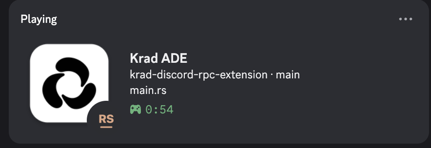
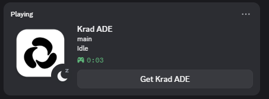
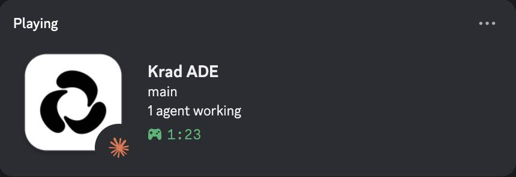
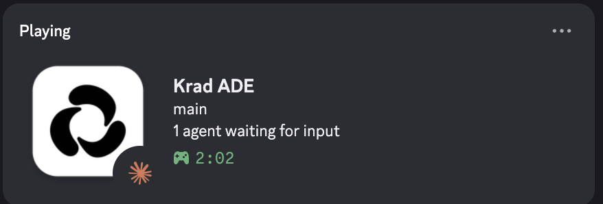

# Krad ADE · Discord RPC

Show your workspace in Discord Rich Presence: the project and its Git branch, the file you are editing with a language icon, what your coding agents are doing, the elapsed session time, and up to two buttons.

[](https://github.com/raloonsoc/krad-discord-rpc-extension/actions/workflows/ci.yml)
[](https://github.com/raloonsoc/krad-discord-rpc-extension/releases/latest)
[](LICENSE)
[](#requirements)

<table>
  <tr>
    <td align="center"></td>
    <td align="center"></td>
  </tr>
  <tr>
    <td align="center"><sub>Editing: project · branch, active file, language icon</sub></td>
    <td align="center"><sub>Idle, as other people see it (with the button)</sub></td>
  </tr>
</table>

The large image is the Krad ADE app asset. The small image is the language of the active file, or the agent you are talking to when the editor is not focused.

> Discord never shows your own Rich Presence buttons to you, only to the people who can see your activity.

## Contents

- [Features](#features)
- [Requirements](#requirements)
- [Installation](#installation)
  - [From GitHub](#from-github-recommended)
  - [From a local folder](#from-a-local-folder)
- [Usage](#usage)
  - [Commands](#commands)
- [Settings](#settings)
  - [Using your own Discord application](#using-your-own-discord-application)
- [Privacy](#privacy)
- [Troubleshooting](#troubleshooting)
- [Icons](#icons)
  - [Languages](#languages)
  - [Agents](#agents)
- [Development](#development)
  - [Build and test](#build-and-test)
  - [Architecture](#architecture)
  - [Releasing](#releasing)
- [Contributing](#contributing)
- [License](#license)

## Features

- **Project and branch.** The workspace group you are in (the one with your latest activity) and its current branch, for example `api · main`. Without a group, the environment name.
- **File and language.** The active file name and an icon for its language.
- **Cursor line.** Optional `:line` suffix, for example `main.rs:42`.
- **Coding agents.** `2 agents working` or `1 agent waiting for input`. Waiting wins over working.
- **Agent icon.** Away from the editor, the small icon becomes the icon of the agent that needs you most.
- **Idle.** The presence turns `Idle` after a few quiet minutes, but never while an agent is working or waiting.
- **Buttons.** `Get Krad ADE` by default, plus an optional `View repository` for the project's `origin`.
- **Titlebar control.** A button next to the ADE/Editor switch pauses and resumes, and shows whether the presence is shared.
- **Privacy controls.** Hide the project, hide the file, or ignore whole groups.

## Requirements

| Component | Requirement |
| --- | --- |
| Krad ADE | 0.4.0 or later. The extension targets API `1.2` and needs the app events introduced in that release. |
| Discord | The desktop app, running on the same machine as Krad ADE. The extension talks to its local IPC socket, so the web client does not work. |
| OS | macOS, Linux or Windows, on x64 or arm64. |
| Rust | A stable Rust toolchain with Cargo, only to build from a local folder. |

The author has tested the extension on macOS, Windows and Linux with Discord desktop.

If Krad ADE does not offer app events, the extension still works without agent information and logs `could not subscribe to app events`.

## Installation

### From GitHub (recommended)

1. In Krad ADE, open the extension manager and add the repository URL:

   ```text
   https://github.com/raloonsoc/krad-discord-rpc-extension
   ```

2. Trust and enable **Discord RPC**.

Krad ADE clones the default branch (`main`). On first start it downloads the binary for your platform from the release pinned in `extension.toml` (currently [v0.1.0](https://github.com/raloonsoc/krad-discord-rpc-extension/releases/tag/v0.1.0)) and verifies it against the SHA-256 in that file. Nothing is built on your machine.

**Update** in the extension manager pulls `main` and asks you to trust the extension again.

Binaries are published for six targets: `darwin_arm64`, `darwin_x64`, `linux_x64`, `linux_arm64`, `win_x64` and `win_arm64`.

### From a local folder

Use this to work on the extension or to run a build of your own.

1. Clone the repository and build the binary into `bin/`:

   ```sh
   git clone https://github.com/raloonsoc/krad-discord-rpc-extension
   cd krad-discord-rpc-extension
   scripts/install.sh          # macOS or Linux, this machine's architecture
   scripts/install.sh all      # ...or both arm64 and x64
   ```

   On Windows, use PowerShell instead:

   ```powershell
   scripts\install.ps1              # this machine's architecture
   scripts\install.ps1 -Arch x64    # ...or a specific one
   ```

   The script builds in release mode, copies the binary to `bin/krad-discord-rpc-<os>-<arch>`, and on macOS verifies its signature. Building the other architecture needs its Rust target first, for example `rustup target add x86_64-apple-darwin`. On Windows, close or disable the extension in Krad ADE first: Windows locks the running `.exe`.

2. In Krad ADE, open the extension manager, add the project folder, then trust and enable **Discord RPC**.

3. After rebuilding, run the install script again and reload the extension.

The install script also rewrites the binaries block in `extension.toml` to point at the files in `bin/`, so Krad ADE runs what you just built. Do not commit that change after a release; restore the manifest with `git checkout extension.toml`.

Two details worth knowing:

- The binary is replaced through a temporary copy, so the installed file gets a new inode. Overwriting a binary that Krad ADE is running makes macOS kill the new process with *Code Signature Invalid*.
- Build output goes to `../krad-discord-rpc-extension-target`, not to `target/` inside the folder. Krad ADE refuses extension folders over 256 MB and fingerprints every file to decide trust.

## Usage

What Discord shows depends on where you are:

- **In the editor.** Details show the project and branch; state shows `file[:line]`, with agent counts appended when agents are active. The small icon is the language of the file.
- **In an agent chat or terminal.** Krad ADE reports no active file when focus leaves the editor. The extension keeps the last file name while it belongs to the group you are in, so the presence does not flicker, and while an agent is active the small icon switches to the agent that needs you most: waiting first, then the most recently updated. A lone agent's tooltip reads for example `Claude Code working`.
- **No file open.** The last saved file appears as `Saved main.rs`, or the agent counts fill the line on their own.
- **Idle.** After `idle-minutes` without activity, and only while no agent is working or waiting, the state line becomes `Idle` and the icon changes. Any activity restores the presence at once.
- **Paused.** The activity is cleared from Discord until you resume.

Krad ADE does not expose the active group, so the project is the last group where you did something: focus or save a file, start an agent or have one ask you for input, or open a session (an agent chat). A background agent finishing does not move it, and a file from another group is not shown under the project you are in.

<table>
  <tr>
    <td align="center"></td>
    <td align="center"></td>
  </tr>
  <tr>
    <td align="center"><sub>In an agent chat: the agent's icon while it works</sub></td>
    <td align="center"><sub>Waiting for input takes priority</sub></td>
  </tr>
</table>

The button next to the ADE/Editor switch mirrors the same switches. It stays highlighted and reads `Discord RPC: sharing` while the presence is shown, turns dim with `Discord RPC: paused` when paused or with `enabled` off, and reads `Discord RPC: Discord not running` while the extension cannot reach the Discord IPC socket. Clicking it runs the same pause/resume command.

The elapsed timer counts from when the extension started.

### Commands

Both live in the command palette:

| Command | ID | Effect |
| --- | --- | --- |
| **Discord RPC: Pause / Resume** | `toggle` | Hides the presence immediately; restores it on resume. Bound to the titlebar button. |
| **Discord RPC: Reconnect** | `reconnect` | Drops the Discord IPC connection and retries right away, useful after restarting Discord. |

Reconnection also happens on its own: the extension retries with exponential backoff from 2 seconds up to 60 seconds while Discord is closed. Pausing or exiting clears the activity.

## Settings

| Key | Label in Krad ADE | Default | Effect |
| --- | --- | --- | --- |
| `client-id` | Discord Client ID | empty | Application ID of your own Discord app. Empty uses the official Krad ADE app (`1569775639412613150`). |
| `show-project` | Show the project | on | Show the group you are in, or the environment name when no group matches. Off hides group, environment and branch names, and the repository button. |
| `show-file` | Show the active file | on | Show the active file, or the last saved one when nothing is open. Off hides file names and the language icon. |
| `show-line` | Show the cursor line | off | Append `:line` to the file. Krad ADE reports the cursor only for the file open when the extension started. Requires `show-file`. |
| `show-branch` | Show the Git branch | on | Append the project's branch, for example `api · main`. Requires `show-project`. |
| `show-agents` | Show the coding agents | on | Show how many agents are working or waiting, and a lone agent's harness in the tooltip. Off hides the counts and agent icons; agents still keep the presence awake. |
| `idle-minutes` | Idle after (minutes) | `5` | Minutes without activity before the presence turns idle. Clamped to 1–120. |
| `show-krad-button` | Show the Krad ADE button | on | Add the **Get Krad ADE** button. |
| `show-repo-button` | Show the repository button | off | Add a **View repository** button for the active project's `origin` remote. Off by default, since the repository may be private. Requires `show-project`. |
| `ignored-groups` | Ignored groups | empty | Comma-separated group names to hide completely. Case-insensitive; agents in those groups do not count either. |
| `enabled` | Enabled | on | Master switch. Turning it off clears the presence until you turn it back on. |

The branch and the `origin` remote are read from `<project>/.git` without running `git`, including worktrees and submodules where `.git` is a `gitdir:` file. Detached HEAD shows the short commit id. Only `https` remotes are linked: `git@host:owner/repo` and `ssh://git@host/owner/repo` are converted, and embedded credentials are removed.

### Using your own Discord application

The extension ships with the official **Krad ADE** Discord application (`1569775639412613150`), so it works without any setup.

To show the activity under your own app instead:

1. Create an application in the [Discord Developer Portal](https://discord.com/developers/applications).
2. Copy **General Information → Application ID** into the **Discord Client ID** setting.
3. Under **Rich Presence → Art Assets**, upload a 512×512 PNG with the key `krad` for the large image.

Leave `client-id` empty to go back to the official app. `krad` is the only Discord asset key; all small icons are sent as URLs, so they need no upload.

## Privacy

The extension talks only to the Discord desktop app on the same machine, through its local IPC socket. It runs no server, sends no telemetry, and makes no network requests of its own.

What the presence can contain:

- The project (group) or environment name, the Git branch, the file name (never the full path), and the cursor line if you enable it.
- Agent counts and, for a single agent, its harness name. Terminal ids and the group ids carried by agent events are never shown.
- The elapsed session time.
- The `origin` URL, only when **View repository** is on.
- A fixed link to the Krad ADE repository, from the **Get Krad ADE** button.

What it never reads: file contents, terminal output, or agent prompts. It reads the active project's `.git` files (`HEAD`, `config`, and `commondir` for worktrees) locally, and nothing else from disk.

To reduce what is shared, turn `show-project` off (also hides the environment, branch and repository button), turn `show-file` off (also hides the language icon), or add groups to `ignored-groups`. Pause and `enabled` off clear everything.

The small icons are HTTPS URLs to PNGs in [`assets/discord`](assets/discord); Discord's client fetches them from `raw.githubusercontent.com`. That request reaches GitHub, not a server of this extension. If the repository stops being public or the files move off `main`, the icons disappear and the rest of the presence keeps working.

## Troubleshooting

**Discord shows nothing.**
Discord desktop is not running, or it runs on another machine. Start Discord desktop on this machine, then run **Discord RPC: Reconnect**.

**Nothing appears after setting a Client ID.**
The Application ID is wrong or the app was deleted. Clear `client-id` to use the official app, or paste the ID again.

**There is no agent information.**
Krad ADE is older than 0.4.0 or does not offer app events. Update Krad ADE; the log shows `could not subscribe to app events`.

**Icons are missing or broken.**
Discord's asset cache, or the GitHub URLs are unavailable. Run **Reconnect**; missing icons do not break the presence. The repository must stay public with the assets on `main`.

**A file shows the generic icon.**
The extension has no icon for that extension. It falls back to `file`.

**The file name stays after switching to a terminal.**
Krad ADE reports no active file when focus leaves the editor, and the last one is kept to avoid flicker. This is expected. The idle timeout retires it, and active agents take over the icon.

**The project is not the one I am in.**
Krad ADE exposes no active group, so the extension uses the last group with your activity: a file, a save, an agent starting or asking for input, or a session. Focus or save a file in the right group to switch back; a file kept from another group is never shown under it.

**The presence says `Idle` while an agent runs.**
The agent belongs to a group in `ignored-groups`, or agent events are unavailable. Check `ignored-groups` and the Krad ADE version.

**The buttons do not show.**
Discord hides your own Rich Presence buttons from you. Check from another account, or ask someone who can see your activity.

**The presence disappeared after restarting Discord.**
The IPC connection was lost. The extension retries on its own, or run **Discord RPC: Reconnect** to retry immediately.

**`extension.toml` points at `bin/` instead of a release.**
`scripts/install.sh` or `scripts/install.ps1` switched it to the local build. Run `git checkout extension.toml` to restore the release manifest.

## Icons

Every icon is a 512×512 PNG in [`assets/discord`](assets/discord), sent to Discord as an external URL. The asset key is the file name without `.png`. The repository must stay public and the files must stay on `main`.

Language matching uses the file extension, case-insensitively: `MAIN.RS` gets the Rust icon.

### Languages

<details>
<summary>All language icons</summary>

| Asset key | Extensions |
| --- | --- |
| `rust` | `.rs` |
| `typescript` | `.ts`, `.mts`, `.cts` |
| `react` | `.tsx`, `.jsx` |
| `javascript` | `.js`, `.mjs`, `.cjs` |
| `python` | `.py`, `.pyi` |
| `go` | `.go` |
| `markdown` | `.md`, `.mdx` |
| `toml` | `.toml` |
| `json` | `.json`, `.jsonc` |
| `yaml` | `.yaml`, `.yml` |
| `shell` | `.sh`, `.bash`, `.zsh`, `.fish` |
| `c` | `.c`, `.h` |
| `cpp` | `.cc`, `.cpp`, `.cxx`, `.hpp`, `.hh` |
| `java` | `.java` |
| `kotlin` | `.kt`, `.kts` |
| `swift` | `.swift` |
| `html` | `.html`, `.htm` |
| `css` | `.css` |
| `sass` | `.scss`, `.sass` |
| `php` | `.php` |
| `ruby` | `.rb` |
| `csharp` | `.cs` |
| `sql` | `.sql` |
| `vue` | `.vue` |
| `svelte` | `.svelte` |
| `lua` | `.lua` |
| `zig` | `.zig` |
| `elixir` | `.ex`, `.exs` |
| `file` | Anything else |
| `idle` | While the workspace is idle |

</details>

### Agents

Harness names match ignoring case, spaces, `-` and `_`. For ACP agents, the id after `Acp:` is matched by substring. An active agent's tooltip appends `working` or `waiting for input` to the name.

| Harness | Asset key | Name |
| --- | --- | --- |
| `Claude Code`, `ClaudeCode`, `claude-code` | `claude` | Claude Code |
| `opencode` | `opencode` | opencode |
| `Codex` | `agent` | Codex |
| `Shell` | `shell` | Shell |
| `ACP` with `gemini` in the id | `googlegemini` | Gemini |
| `ACP` with `copilot` in the id | `githubcopilot` | Copilot |
| `ACP` with `cursor` in the id | `cursor` | Cursor |
| `ACP` with `mistral` in the id | `mistralai` | Mistral |
| `ACP` with `ollama` in the id | `ollama` | Ollama |
| `ACP` with `claude` in the id | `claude` | Claude |
| `ACP` with any other id | `agent` | The id itself |
| `Gateway`, unknown harness, or none | `agent` | Agent |

The brand icons come from [Simple Icons](https://simpleicons.org), released under CC0; the brands themselves belong to their owners. The `agent`, language, `file` and `idle` icons are drawn for this extension.

## Development

### Build and test

```sh
cargo test
cargo clippy --all-targets -- -D warnings
cargo fmt --all -- --check
scripts/install.sh
```

Reload the extension in Krad ADE after installing. CI ([`.github/workflows/ci.yml`](.github/workflows/ci.yml)) runs the format check, clippy and the tests on macOS, Ubuntu and Windows for every push and pull request to `main`.

`krad-extension-sdk` comes from the Git commit pinned in `Cargo.toml`, so a build needs a Git client; the CI runners have one.

### Architecture

Dependencies point inward: `domain` is pure, `adapters` own the outside world, and `app` wires them together. `main` only starts the app.

```text
src/
  main.rs                     start the Discord thread and the extension
  domain/                     pure model; the caller injects `now`
    event.rs                  the events the extension reacts to
    workspace/                workspace state and how events change it
    agents.rs                 agent snapshots, counts and priority
    settings.rs               defaults and ranges, without the host types
    indicator.rs              the titlebar button's highlight and tooltip
    presence/                 state + settings -> what Discord receives
      text.rs                 file and agent labels, UTF-8 truncation
      icons.rs                language and harness asset catalogue
      buttons.rs              buttons and Discord's limits
  adapters/                   the outside world
    krad/                     host SDK: hooks, settings, conversions
      convert.rs              SDK types -> domain types
      settings.rs             SettingsValues -> Settings
      titlebar.rs             sends the button state to the host
    discord/                  thread that owns the Discord IPC client
      limiter.rs              debounce, rate window and reconnect backoff
      activity.rs             PresenceView -> Discord activity
    git/                      branch and origin read from .git
  app/                        orchestration
    monitor.rs                timer thread: Git refresh and idle
```

Each module keeps its tests in a sibling `tests.rs` when they outgrow the file.

`krad-extension-sdk` is pinned to the Git commit `9c0812c` (release 0.4.0) because the 0.4.0 crate on crates.io predates the app event API. Switch back to the crates.io version in `Cargo.toml` once a release includes it.

### Releasing

1. Bump `version` in `Cargo.toml`, refresh the lock file and commit the bump on `main`:

   ```sh
   cargo check
   git commit -am "Bump version to 0.2.0"
   ```

2. Tag that commit and push the tag:

   ```sh
   git tag v0.2.0
   git push origin v0.2.0
   ```

   Pushing a `v*` tag publishes the release.

3. The [Release workflow](.github/workflows/release.yml) tests and builds `darwin_arm64`, `darwin_x64`, `linux_x64`, `linux_arm64`, `win_x64` and `win_arm64` on GitHub-hosted runners, creates the GitHub Release with `krad-discord-rpc-<os>-<arch>[.exe]` assets, and rewrites the binaries block and `version` in `extension.toml` with `scripts/binaries.py release` before pushing that commit to `main`. The two cross-compiled targets (`darwin_x64`, `win_arm64`) only build.

To redo the manifest step by hand, put the binaries in `dist/` under those names and run:

```sh
python3 scripts/binaries.py release 0.2.0 dist   # url + sha256 for tag v0.2.0
python3 scripts/binaries.py local                # back to bin/ for development
```

`scripts/binaries.py` only touches the block between the `BEGIN BINARIES` and `END BINARIES` markers and the top-level `version` line.

## Contributing

Issues and pull requests are welcome. Before opening a pull request, run `cargo fmt --all`, `cargo clippy --all-targets -- -D warnings` and `cargo test`; CI must pass. Keep changes focused and explain the behaviour they change.

When adding a language or harness icon, add the PNG to `assets/discord`, wire it in `src/domain/presence/icons.rs`, and commit it to `main` before expecting Discord to show it.

## License

[MIT](LICENSE). Brand icons in `assets/discord/` come from [Simple Icons](https://simpleicons.org) (CC0); the brands belong to their owners.
